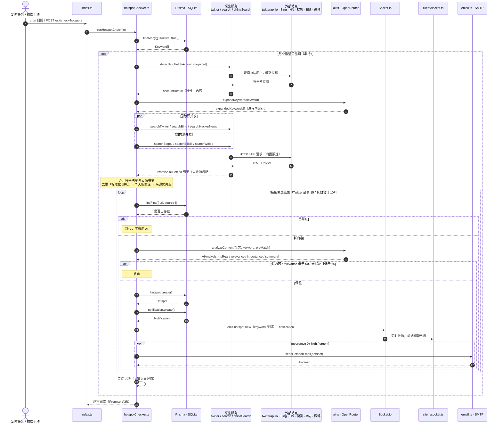

# HotPulse · AI 热点监控工具

> 输入关键词，让 AI 从全网 8+ 信息源自动抓取、甄别、分析热点，并通过 WebSocket 实时推送到浏览器、通过邮件提醒重要情报。

一个前后端分离的 AI 实战项目：后端基于 Express 5 + Prisma，前端基于 React 19 + Vite，借助 OpenRouter 接入大模型完成真假识别与相关性分析，并把整套监控能力封装为可复用的 Agent Skills 技能包。

> 项目原作：[程序员鱼皮 · AI 热点监控工具](https://www.codefather.cn/)，本 README 聚焦功能模块与系统架构的工程说明。

---

## 目录

- [一、项目简介](#一项目简介)
- [二、六大功能模块](#二六大功能模块)
- [三、系统架构](#三系统架构)
- [四、项目结构](#四项目结构)
- [五、快速开始](#五快速开始)
- [六、API 接口速览](#六api-接口速览)
- [七、Agent Skills 技能包](#七agent-skills-技能包)
- [八、相关文档](#八相关文档)

---

## 一、项目简介

作为内容创作者或技术人，需要第一时间掌握领域动态（如大模型更新）。手动刷遍各平台既慢又容易漏。本项目把这件事交给 AI：

1. 你配置一批**监控关键词**；
2. 系统定时从 **Twitter、Bing、HackerNews、搜狗、Bilibili、微博** 等信息源并行抓取内容；
3. AI 自动完成**查询扩展 → 真假识别 → 相关性打分 → 重要性分级 → 摘要生成**；
4. 过滤掉低质、无关内容后入库，并通过 **实时推送 + 邮件 + 站内通知** 三通道告知你；
5. 同一套能力还能以 **Agent Skills** 形式被 Cursor / Claude Code 等 AI 工具直接调用。

---

## 二、六大功能模块

### 🗝️ 1. 关键词管理
| 能力 | 说明 |
|------|------|
| 添加 / 删除监控关键词 | 关键词唯一，重复添加返回冲突提示 |
| 激活 / 暂停单个关键词 | 一键切换状态，仅激活词参与定时巡检 |
| ⭐ AI 自动扩展查询变体 | Query Expansion：生成别名、缩写、中英对照等 5–15 个变体并缓存，用于文本预匹配 |
| B 站账号智能检测 | 关键词命中 UP 主时，直接抓取该账号最新投稿 |

### 🔍 2. 热点采集与分析
| 能力 | 说明 |
|------|------|
| ⭐ 8+ 数据源并行采集 | `Promise.allSettled` 并发抓取，单源失败不影响整体；内置频率限制与随机 UA |
| ⭐ AI 真实性验证 | 过滤标题党、假新闻、营销软文（`isReal`） |
| ⭐ AI 相关性评分（0–100） | 结合关键词变体预匹配严格打分，低于 50 分过滤 |
| AI 重要性分级 | `low / medium / high / urgent` 四档 |
| AI 智能摘要生成 | 一句话说明内容与监控关键词的关联 |
| AI 相关性分析理由 | 给出打分依据，前端可展开查看 |

### 📊 3. 信息展示与筛选
| 能力 | 说明 |
|------|------|
| 热点雷达仪表盘 | 总热点 / 今日新增 / 紧急热点 / 生效监控词四张统计卡 |
| ⭐ 5 种排序方式 | 最新、发布时间、相关性、重要性、热度（加权综合分） |
| ⭐ 多维度筛选 | 按来源、重要性、关键词、真实性、时间范围筛选 |
| 分页加载 | 服务端分页，参数回传前端 |
| 展开 / 折叠分析详情 | AI 理由与原始内容均可单独或一键展开 |
| 一键跳转原文 | 直达信息源 |

### 🔔 4. 通知系统
| 能力 | 说明 |
|------|------|
| ⭐ WebSocket 实时推送 | 基于房间（`keyword:<词>`）按关键词定向推送新热点 |
| 邮件通知（high/urgent） | 通过 Nodemailer/SMTP，仅重要级别触发，附 HTML 模板 |
| 站内通知管理 | 通知列表、单条已读、全部已读、删除 / 清空 |
| 已读 / 未读状态 | 未读计数实时联动顶部铃铛 |

### 🌐 5. 全网搜索
| 能力 | 说明 |
|------|------|
| 关键词全网搜索 | 手动输入关键词即时检索，不写入数据库 |
| 多数据源聚合结果 | 聚合搜索源并去重 |
| 搜索结果筛选排序 | 复用与仪表盘相同的筛选 / 排序组件（前端内存计算） |

### 🤖 6. Agent Skills
| 能力 | 说明 |
|------|------|
| ⭐ 完全自包含技能包 | `skills/hot-monitor`，无需后端与数据库即可独立运行 |
| ⭐ 多 AI 工具兼容 | 标准 `SKILL.md` 规范，可供 Cursor / VSCode Copilot / Claude Code 等加载 |
| Python 采集脚本 | 多源搜索脚本输出 JSON，供 Agent 自行分析 |
| 分析框架文档 | 提供真实性 / 相关性 / 重要性判定指南与报告模板 |

---

## 三、系统架构

### 3.1 整体分层

```
┌─────────────────────────────────────────────────────────────┐
│  浏览器  React 19 SPA（HotPulse）                             │
│  • 热点雷达 / 监控词 / 全网搜索 三个视图                        │
│  • Tailwind CSS + Framer Motion + Aceternity 风格组件          │
│  • api.ts（REST） · socket.ts（WebSocket）                    │
└───────────────┬─────────────────────────┬─────────────────────┘
                │ HTTP /api               │ WS /socket.io
                ▼                         ▼
┌─────────────────────────────────────────────────────────────┐
│  Vite Dev Server（:5173）  —— proxy 代理到 :3001              │
└───────────────┬─────────────────────────┬─────────────────────┘
                │                         │
                ▼                         ▼
┌─────────────────────────────────────────────────────────────┐
│  Express 5 服务（:3001）                                      │
│  Routes: /keywords  /hotspots  /notifications  /settings      │
│  • /api/health 健康检查   • /api/check-hotspots 手动触发       │
│  • Socket.io 房间订阅 / 事件推送                              │
│  • node-cron 每 30 分钟定时巡检                               │
└───────────────┬─────────────────────────────────────────────┘
                │
                ▼
┌─────────────────────────────────────────────────────────────┐
│  Services 业务层                                              │
│  jobs/hotspotChecker（巡检编排）                              │
│  services/: twitter · search · chinaSearch · ai · email       │
└───────────────┬─────────────────────────────────────────────┘
                │
                ▼
┌─────────────────────────────────────────────────────────────┐
│  Prisma ORM  →  SQLite（file:./dev.db）                       │
│  Keyword · Hotspot · Notification · Setting                  │
└─────────────────────────────────────────────────────────────┘
```

### 3.2 核心采集流水线

定时（每 30 分钟）或手动触发 `runHotspotCheck`，对每个激活关键词依次执行：

```
读取激活关键词
      │
      ├─① B 站账号检测 ──→ 命中则抓取该 UP 主最新投稿
      │
      ├─② Query Expansion ──→ AI 扩展关键词变体（带缓存）
      │
      ├─③ 多源并行采集 ──→ Twitter / Bing / HackerNews / 搜狗 / B站 / 微博
      │                     （Promise.allSettled，容错）
      │
      ├─④ 数据清洗 ──→ URL 去重 → 7 天新鲜度过滤 → 来源优先级排序
      │
      ├─⑤ 配额分配 ──→ Twitter 最多 15 条，其他源共 10 条
      │
      ├─⑥ AI 分析 ──→ 真假识别 + 相关性评分/理由 + 重要性 + 摘要
      │
      ├─⑦ 阈值过滤 ──→ 非真实 / 相关性<50 / 未提及且<65 一律丢弃
      │
      └─⑧ 入库 & 通知 ──→ 写 Hotspot + 站内 Notification
                            → WebSocket 按词推送 → high/urgent 发邮件
```

### 3.3 技术栈

| 层级 | 技术 | 说明 |
|------|------|------|
| 前端 | React 19 + Vite 7 + TypeScript 5.9 | SPA，Vite 代理 REST 与 WebSocket |
| UI | Tailwind CSS 4 + Framer Motion + Lucide | 深色科技风，Aceternity 风格背景组件 |
| 后端 | Express 5 + TypeScript（tsx） | REST API + Socket.io 服务 |
| AI | OpenRouter SDK（DeepSeek V3.2） | 查询扩展、内容分析；未配置时有降级逻辑 |
| 采集 | axios + cheerio + twitterapi.io | 搜索引擎页面解析 + 平台公开 API |
| 定时任务 | node-cron | 每 30 分钟巡检 |
| 数据库 | SQLite + Prisma 6 | 4 张表，轻量本地存储 |
| 实时通信 | Socket.io 4 | 按关键词房间推送新热点 |
| 邮件 | Nodemailer | high/urgent 热点 HTML 邮件 |
| 测试 | Vitest | AI 相关性与热点排序单测 |
| 技能包 | Python（requests + beautifulsoup4） | 自包含 Agent Skills 采集脚本 |

### 3.4 数据模型

```
Keyword  1 ──── * Hotspot        （关键词 → 热点，删除关键词时外键置空）
Hotspot  1 ──── 0..1 Notification（热点 → 站内通知）
Setting  独立键值表              （系统配置）
```

- **Keyword**：`text`(唯一)、`category`、`isActive`
- **Hotspot**：标题、内容、URL、来源、真假、相关性、分析理由、重要性、摘要、互动/作者指标、关联关键词
- **Notification**：`type`、标题、内容、`isRead`、关联热点
- **Setting**：`key` / `value` 通用配置

### 3.5 数据源

| 来源 | 接入方式 | 备注 |
|------|----------|------|
| Twitter / X | twitterapi.io（需 Key） | Top 2 页 + Latest 1 页，本地质量过滤 |
| Bing / Google / DuckDuckGo | 页面抓取 + cheerio | 随机 UA + 频率限制 |
| HackerNews | Algolia 官方 API | 近 24h story |
| 搜狗 | 页面抓取 | 替代百度，反爬较宽松 |
| Bilibili | 公开 Web API | 视频搜索、用户搜索、账号投稿 |
| 微博 | 热搜公开 API | 关键词匹配热搜话题 |

> 默认巡检并行调用 Twitter / Bing / HackerNews / 搜狗 / Bilibili / 微博 六个源；Google、DuckDuckGo 的采集实现已内置于 `services/search.ts`。

---

## 四、项目结构

### 4.1 目录总览

```
monitor/
├── server/                              # 后端：Express 5 + Prisma + Socket.io + node-cron
│   ├── src/
│   │   ├── index.ts                     # 进程入口：路由挂载 / WebSocket / 定时任务 / 手动触发
│   │   ├── db.ts                        # PrismaClient 单例
│   │   ├── types.ts                     # 后端共享类型（采集结果 / AI 结果 / Twitter 过滤配置）
│   │   ├── routes/                      # HTTP 层：只做参数校验与数据库读写
│   │   │   ├── keywords.ts
│   │   │   ├── hotspots.ts
│   │   │   ├── notifications.ts
│   │   │   └── settings.ts
│   │   ├── services/                    # 外部 IO 层：采集 / AI / 邮件
│   │   │   ├── twitter.ts               # Twitter / X
│   │   │   ├── search.ts                # Bing / Google / DuckDuckGo / HackerNews
│   │   │   ├── chinaSearch.ts           # 搜狗 / B站 / 微博
│   │   │   ├── ai.ts                    # OpenRouter：查询扩展 + 内容分析
│   │   │   └── email.ts                 # SMTP 邮件
│   │   ├── jobs/hotspotChecker.ts       # 巡检编排：唯一串联“采集→过滤→AI→入库→通知”的文件
│   │   ├── utils/sortHotspots.ts        # 重要性 / 热度综合分的内存排序
│   │   ├── test-sources.ts              # 本地脚本：逐个测试 6 个采集源是否可用
│   │   └── __tests__/                   # Vitest 单测
│   ├── prisma/
│   │   ├── schema.prisma                # 数据模型（Keyword / Hotspot / Notification / Setting）
│   │   └── migrations/                  # 3 个历史迁移
│   ├── .env.example                     # 环境变量模板
│   └── package.json                     # dev / build / db:* / test 脚本
├── client/                              # 前端：React 19 + Vite 7
│   ├── src/
│   │   ├── App.tsx                      # 单文件主应用：仪表盘 / 监控词 / 全网搜索 三个 Tab
│   │   ├── main.tsx                     # React 挂载入口
│   │   ├── index.css                    # Tailwind 4 + 全局主题样式
│   │   ├── components/
│   │   │   ├── FilterSortBar.tsx        # 筛选 + 排序栏（仪表盘与搜索页共用）
│   │   │   └── ui/                      # 纯装饰组件（光束 / 流星 / 聚光灯 / 边框 / 文字动画）
│   │   ├── services/
│   │   │   ├── api.ts                   # 所有 REST 接口封装
│   │   │   └── socket.ts                # WebSocket 连接与订阅
│   │   ├── utils/
│   │   │   ├── sortHotspots.ts          # 前端内存排序（与后端规则对齐）
│   │   │   └── relativeTime.ts          # “x 分钟前”时间格式化
│   │   └── lib/utils.ts                 # cn() 类名合并工具
│   ├── vite.config.ts                   # 开发代理：/api 与 /socket.io → :3001
│   └── index.html
├── skills/hot-monitor/                  # 独立 Agent Skills 包（不依赖后端与数据库）
│   ├── SKILL.md                         # 技能说明与工作流
│   ├── references/
│   │   ├── search-sources.md            # 各数据源说明
│   │   └── analysis-guide.md            # 真假 / 相关性 / 重要性判定标准
│   └── scripts/
│       ├── search_web.py                # 国际源采集
│       ├── search_china.py              # 国内源采集
│       ├── search_twitter.py            # Twitter 采集（需 Key）
│       ├── generate_report.py           # Markdown 热点报告生成
│       └── requirements.txt
├── docs/                                # 文档与架构图
└── README.md
```

### 4.2 巡检时序与数据流向



**时序要点**（按 [hotspotChecker.ts](server/src/jobs/hotspotChecker.ts#L40-L248) 实际执行顺序）：

- **串行**：关键词逐个处理；单条候选也是逐条 `await` AI 分析；每个关键词结束固定 `sleep 2s` 限速。
- **并行**：6 个采集调用同时发起（`Promise.allSettled`），任一源失败不影响其他源。
- **短路**：已存在的 `url + source` 直接跳过，不调用 AI；`isReal=false`、`relevance<50`、或“未提及关键词且 `<65`”都会在写库前丢弃。
- **返回出口**：每个采集函数返回 `SearchResult[]` 给巡检器；`ai.ts` 返回 `AIAnalysis` 给巡检器；`email.ts` 返回 `boolean`。巡检器是唯一决定“入库 / 丢弃 / 推送”的角色。
- **推送**：入库成功后先发 `hotspot:new` 到 `keyword:<词>` 房间，再广播 `notification`，均经 `index.ts` 由 Socket.io 送达前端。

### 4.3 后端文件职责

| 文件 | 职责 | 典型改动 |
|------|------|----------|
| [server/src/index.ts](server/src/index.ts) | 进程入口。挂载 4 组 REST 路由、`/api/health`、`POST /api/check-hotspots`；处理 Socket.io 连接与房间订阅；注册 node-cron | 改服务端口、定时频率（`*/30 * * * *`）、WebSocket 事件名、手动触发接口 |
| [server/src/db.ts](server/src/db.ts) | 导出全局 `prisma` 实例 | 一般无需改动 |
| [server/src/types.ts](server/src/types.ts) | `SearchResult`、`AIAnalysis`、`TwitterFilterConfig` 等共享类型 | **新增数据源时先在这里补字段**；调整 AI 返回结构 |
| [server/src/jobs/hotspotChecker.ts](server/src/jobs/hotspotChecker.ts) | **巡检主编排**：账号检测 → 查询扩展 → 6 源并发 → 去重 → 新鲜度 → 优先级 → 配额 → AI → 阈值过滤 → 入库 → 推送 / 邮件 | **调整默认采集源、配额、7 天新鲜度、来源优先级、过滤阈值、邮件触发条件** |
| [server/src/routes/keywords.ts](server/src/routes/keywords.ts) | 关键词 CRUD 与激活 / 暂停 | 关键词新增字段（如来源配置、分类） |
| [server/src/routes/hotspots.ts](server/src/routes/hotspots.ts) | 热点列表（分页 / 筛选 / 排序）、统计、详情、删除；`POST /search` 手动全网搜索（仅 Twitter+Bing，分析前 10 条，不入库） | 增删筛选参数、改分页、扩展手动搜索源、改搜索分析条数 |
| [server/src/routes/notifications.ts](server/src/routes/notifications.ts) | 站内通知列表、未读数、已读、删除 / 清空 | 通知类型与状态逻辑 |
| [server/src/routes/settings.ts](server/src/routes/settings.ts) | `Setting` 键值表 CRUD（当前前端未使用，巡检也不读取） | 要做“前端可配置”时从这里接入并让巡检读取 |
| [server/src/services/twitter.ts](server/src/services/twitter.ts) | twitterapi.io 高级搜索；`TWITTER_FILTER_CONFIG` 控制点赞 / 转发 / 浏览 / 粉丝阈值 | **改 Twitter 采集范围、质量过滤阈值、翻页数** |
| [server/src/services/search.ts](server/src/services/search.ts) | 国际源采集：Bing / Google / DuckDuckGo 页面解析 + HackerNews Algolia API；`deduplicateResults`、`searchAll` | **改国际源解析规则；Google / DuckDuckGo 已实现但未接入默认巡检** |
| [server/src/services/chinaSearch.ts](server/src/services/chinaSearch.ts) | 国内源采集：搜狗、B站视频 / 用户 / UP 主投稿、微博热搜；`detectAndFetchAccount` 做账号检测 | **改国内源解析规则、B站账号检测逻辑** |
| [server/src/services/ai.ts](server/src/services/ai.ts) | OpenRouter `deepseek/deepseek-v3.2`：`expandKeyword` 查询扩展（进程内缓存）、`preMatchKeyword` 预匹配、`analyzeContent` 内容分析、`batchAnalyze` | **改模型名、提示词、判定字段、无 Key 降级策略** |
| [server/src/services/email.ts](server/src/services/email.ts) | Nodemailer SMTP：`sendHotspotEmail` 单条 HTML 邮件；`sendDigestEmail` 日报（已实现但未被调用） | **改邮件模板、收件人、SMTP 配置；启用日报时在巡检里调用 digest** |
| [server/src/utils/sortHotspots.ts](server/src/utils/sortHotspots.ts) | `importance` 与 `hot` 两种内存排序及热度加权公式 | 调整热度权重、重要性顺序 |
| [server/src/test-sources.ts](server/src/test-sources.ts) | 本地逐个验证采集源 | 新增源后加一条测试 |
| [server/src/__tests__/](server/src/__tests__/) | AI 相关性与热点排序单测 | 改判定 / 排序逻辑后同步补测 |

### 4.4 前端文件职责

| 文件 | 职责 | 典型改动 |
|------|------|----------|
| [client/src/App.tsx](client/src/App.tsx) | **单文件主应用**。状态、数据加载、WebSocket 监听、全部页面都在这里：仪表盘（约 470 行起）、监控词（约 877 行起）、全网搜索（约 974 行起） | 改页面布局、交互、卡片展示、Tab 结构 |
| [client/src/components/FilterSortBar.tsx](client/src/components/FilterSortBar.tsx) | 来源 / 重要性 / 关键词 / 真实性 / 时间筛选 + 5 种排序 | 增加筛选维度或排序项 |
| [client/src/components/ui/](client/src/components/ui/) | 背景光束、流星、聚光灯、动态边框、文字动画等纯视觉组件 | 调整装饰效果 |
| [client/src/services/api.ts](client/src/services/api.ts) | 所有 REST 请求封装（关键词 / 热点 / 通知 / 设置 / 手动触发） | 接口路径或请求参数变化 |
| [client/src/services/socket.ts](client/src/services/socket.ts) | Socket.io 客户端连接、`subscribe / unsubscribe`、事件回调 | 新增实时事件、改连接地址 |
| [client/src/utils/sortHotspots.ts](client/src/utils/sortHotspots.ts) | 前端内存排序（搜索结果用） | 与后端排序规则保持一致 |
| [client/src/utils/relativeTime.ts](client/src/utils/relativeTime.ts) | 相对时间显示 | 时间格式 |
| [client/src/lib/utils.ts](client/src/lib/utils.ts) | `cn()` 类名合并 | 一般无需改动 |
| [client/src/index.css](client/src/index.css) | Tailwind 4 引入与全局主题变量 | 改主题色、全局样式 |
| [client/vite.config.ts](client/vite.config.ts) | 开发代理 `/api`、`/socket.io` → `localhost:3001` | 改后端地址、端口、代理规则 |

### 4.5 技能包与文档

| 路径 | 说明 |
|------|------|
| [skills/hot-monitor/SKILL.md](skills/hot-monitor/SKILL.md) | 技能触发条件与完整工作流（搜索 → 分析 → 出报告） |
| [skills/hot-monitor/references/search-sources.md](skills/hot-monitor/references/search-sources.md) | 各数据源能力与使用方式 |
| [skills/hot-monitor/references/analysis-guide.md](skills/hot-monitor/references/analysis-guide.md) | 真实性 / 相关性 / 重要性的判定标准 |
| [skills/hot-monitor/scripts/search_web.py](skills/hot-monitor/scripts/search_web.py) | 国际源采集脚本，输出 JSON |
| [skills/hot-monitor/scripts/search_china.py](skills/hot-monitor/scripts/search_china.py) | 国内源采集脚本，输出 JSON |
| [skills/hot-monitor/scripts/search_twitter.py](skills/hot-monitor/scripts/search_twitter.py) | Twitter 采集脚本（需 `TWITTER_API_KEY`） |
| [skills/hot-monitor/scripts/generate_report.py](skills/hot-monitor/scripts/generate_report.py) | 生成 Markdown 热点报告，**改报告样式 / 章节在这里** |
| [docs/LOCAL_SETUP.md](docs/LOCAL_SETUP.md) | 本地启动与排错 |
| [docs/API_INTEGRATION.md](docs/API_INTEGRATION.md) | 接口对接细节 |
| [docs/REQUIREMENTS.md](docs/REQUIREMENTS.md) | 原始需求 |
| [docs/项目总览.md](docs/项目总览.md) | 功能演示与架构说明 |
| [docs/architecture/](docs/architecture/) | 交互式架构图及其证据 JSON |

### 4.6 常见改动速查

| 我想…… | 去哪里改 |
|---------|----------|
| 新增 / 移除一个采集源 | 先在 `services/` 实现采集函数，再改 [hotspotChecker.ts](server/src/jobs/hotspotChecker.ts#L76-L117) 的 `Promise.allSettled` 数组与 `sources` 映射，最后补 `prioritizeResults` 优先级和 `types.ts` 的 `source` 枚举 |
| 改 Bing / 搜狗 / B站 / 微博的解析规则 | [search.ts](server/src/services/search.ts) / [chinaSearch.ts](server/src/services/chinaSearch.ts) |
| 改 Twitter 抓取与质量门槛 | [twitter.ts](server/src/services/twitter.ts) 中的 `TWITTER_FILTER_CONFIG` 与 `searchTwitter` |
| 改 AI 真假判定 / 相关性规则 | [ai.ts](server/src/services/ai.ts) 的 `buildAnalysisPrompt`；阈值在 [hotspotChecker.ts](server/src/jobs/hotspotChecker.ts#L155-L171) |
| 换 AI 模型 | [ai.ts](server/src/services/ai.ts) 中两处 `model: 'deepseek/deepseek-v3.2'` |
| 改巡检频率 | [index.ts](server/src/index.ts#L69-L78) 的 cron 表达式 |
| 改每条关键词的处理配额 / 新鲜度 | 新鲜度与来源优先级在 [hotspotChecker.ts](server/src/jobs/hotspotChecker.ts#L12-L38)；`TWITTER_QUOTA` / `OTHER_QUOTA` 在 [同文件 L127-L130](server/src/jobs/hotspotChecker.ts#L127-L130) |
| 改邮件触发级别 / 模板 / 收件人 | [email.ts](server/src/services/email.ts) + [hotspotChecker.ts](server/src/jobs/hotspotChecker.ts#L232-L235) 的 `importance` 判断；收件人在 `.env` |
| 让“来源”可由前端配置 | 需新增 `Keyword` 字段或新表（[schema.prisma](server/prisma/schema.prisma)）→ [keywords 路由](server/src/routes/keywords.ts) → [hotspotChecker.ts](server/src/jobs/hotspotChecker.ts#L76-L91) 按词过滤源 → 前端 [App.tsx](client/src/App.tsx) 关键词表单 |
| 新增 / 修改 API | [routes/](server/src/routes/) + 前端 [api.ts](client/src/services/api.ts) |
| 改数据库字段 | [schema.prisma](server/prisma/schema.prisma)，然后 `npx prisma migrate dev` |
| 改页面 / 卡片 / Tab | [client/src/App.tsx](client/src/App.tsx) |
| 改筛选排序 UI | [FilterSortBar.tsx](client/src/components/FilterSortBar.tsx)（前后端排序规则分别在两处 `sortHotspots.ts`） |
| 改实时推送 | 服务端 [index.ts](server/src/index.ts#L51-L67) 与 [hotspotChecker.ts](server/src/jobs/hotspotChecker.ts#L222-L230)；前端 [socket.ts](client/src/services/socket.ts) |
| 改技能包采集 / 报告 | [skills/hot-monitor/scripts/](skills/hot-monitor/scripts/) 与 [analysis-guide.md](skills/hot-monitor/references/analysis-guide.md) |

---

## 五、快速开始

### 前置条件

- Node.js ≥ 18（推荐 20 LTS）
- 一个 [OpenRouter API Key](https://openrouter.ai/settings/keys)（必需，用于 AI 分析）

### 1. 安装依赖

```bash
# 后端
cd server && npm install && npx prisma generate && npx prisma db push

# 前端
cd ../client && npm install
```

### 2. 配置环境变量

```bash
cp server/.env.example server/.env
```

编辑 `server/.env`，至少填入 OpenRouter Key：

```env
DATABASE_URL="file:./dev.db"
PORT=3001
CLIENT_URL=http://localhost:5173
OPENROUTER_API_KEY=sk-or-v1-你的key
# 可选：Twitter 采集
TWITTER_API_KEY=你的key
# 可选：邮件通知（high/urgent）
SMTP_HOST=smtp.qq.com
SMTP_PORT=465
SMTP_SECURE=true
SMTP_USER=你的邮箱
SMTP_PASS=邮箱授权码
NOTIFY_EMAIL=接收邮箱
```

### 3. 启动服务（两个终端）

```bash
# 终端 1：后端（:3001）
cd server && npm run dev

# 终端 2：前端（:5173）
cd client && npm run dev
```

访问 **http://localhost:5173** 即可开始监控。

| 服务 | 地址 |
|------|------|
| 前端页面 | http://localhost:5173 |
| 后端 API | http://localhost:3001 |
| 健康检查 | http://localhost:3001/api/health |
| 数据库管理 | `cd server && npx prisma studio` |

> 详细排错与保姆级步骤见 [docs/LOCAL_SETUP.md](docs/LOCAL_SETUP.md)。

---

## 六、API 接口速览

| 方法 | 路径 | 说明 |
|------|------|------|
| `GET` | `/api/keywords` | 关键词列表（含热点数） |
| `POST` | `/api/keywords` | 新增关键词 |
| `PUT` | `/api/keywords/:id` | 修改关键词 |
| `PATCH` | `/api/keywords/:id/toggle` | 激活 / 暂停 |
| `DELETE` | `/api/keywords/:id` | 删除关键词 |
| `GET` | `/api/hotspots` | 热点列表（分页 / 筛选 / 排序） |
| `GET` | `/api/hotspots/stats` | 统计数据 |
| `POST` | `/api/hotspots/search` | 全网聚合搜索（不入库） |
| `DELETE` | `/api/hotspots/:id` | 删除热点 |
| `GET` | `/api/notifications` | 通知列表 + 未读数 |
| `PATCH` | `/api/notifications/:id/read` | 单条已读 |
| `PATCH` | `/api/notifications/read-all` | 全部已读 |
| `GET/PUT` | `/api/settings` | 系统配置读写 |
| `POST` | `/api/check-hotspots` | 手动触发一次巡检 |

**WebSocket 事件**：客户端 `subscribe / unsubscribe`（按关键词订阅房间）；服务端推送 `hotspot:new`、`notification`。

---

## 七、Agent Skills 技能包

`skills/hot-monitor` 是一个**无需后端、无需数据库**的独立技能包，可被主流 AI 编程工具加载：

```bash
cd skills/hot-monitor
pip install requests beautifulsoup4
export TWITTER_API_KEY=your_key    # 可选

python scripts/search_web.py "AI programming" --sources bing,hackernews
python scripts/search_china.py "AI编程" --sources sogou,bilibili,weibo
python scripts/search_twitter.py "AI programming"    # 需 Key
```

脚本统一输出 JSON，Agent 依据 `references/analysis-guide.md` 自行完成真实性 / 相关性 / 重要性分析，并用 `generate_report.py` 生成 Markdown 报告。详见 [skills/hot-monitor/SKILL.md](skills/hot-monitor/SKILL.md)。

---

## 八、相关文档

- [本地运行指南](docs/LOCAL_SETUP.md) — 环境准备与逐步启动
- [API 接入说明](docs/API_INTEGRATION.md) — 接口对接细节
- [需求文档](docs/REQUIREMENTS.md) — 功能需求来源
- [Agent Skills](skills/hot-monitor/SKILL.md) — 技能包使用说明
