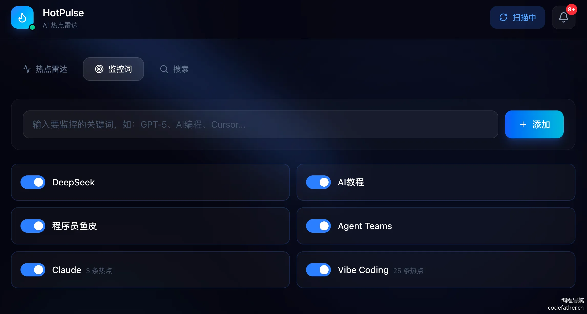
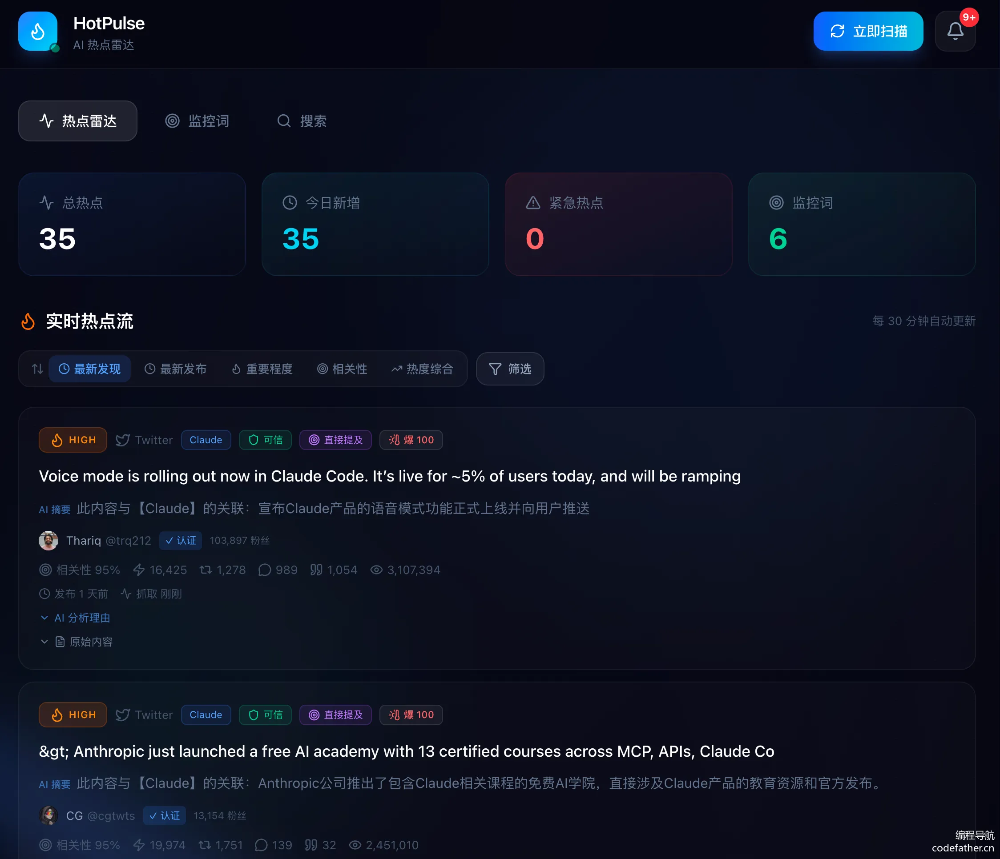
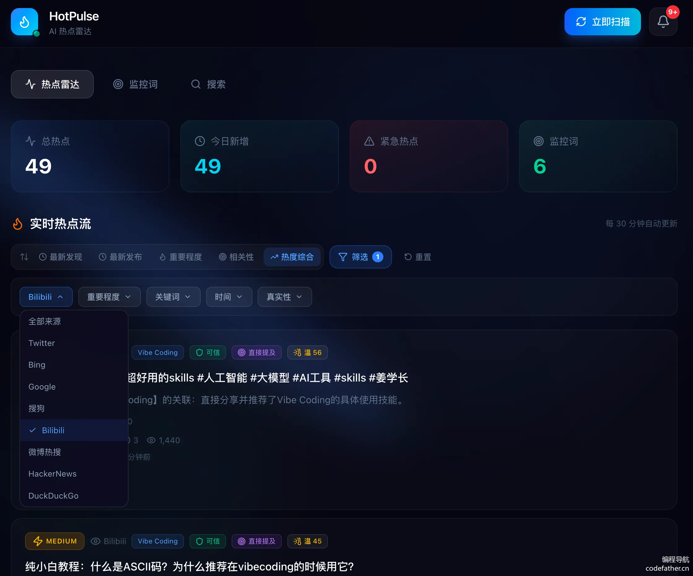
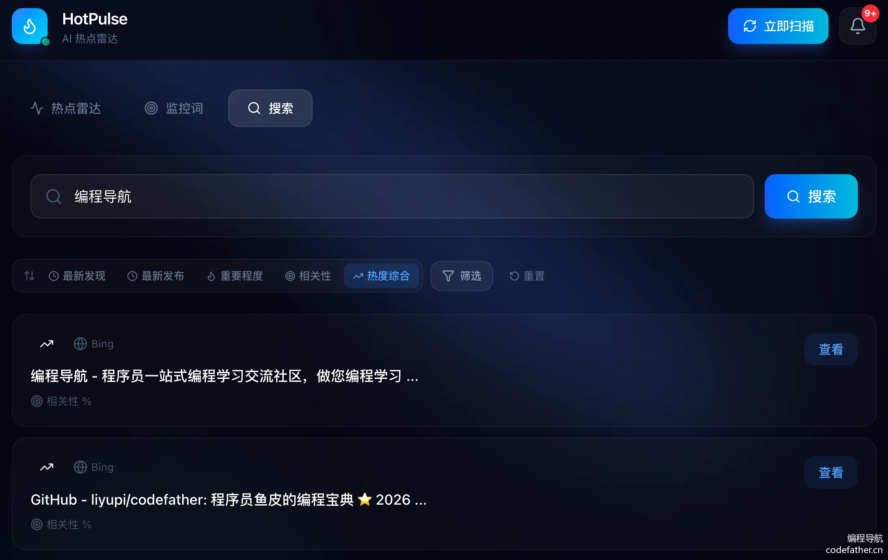
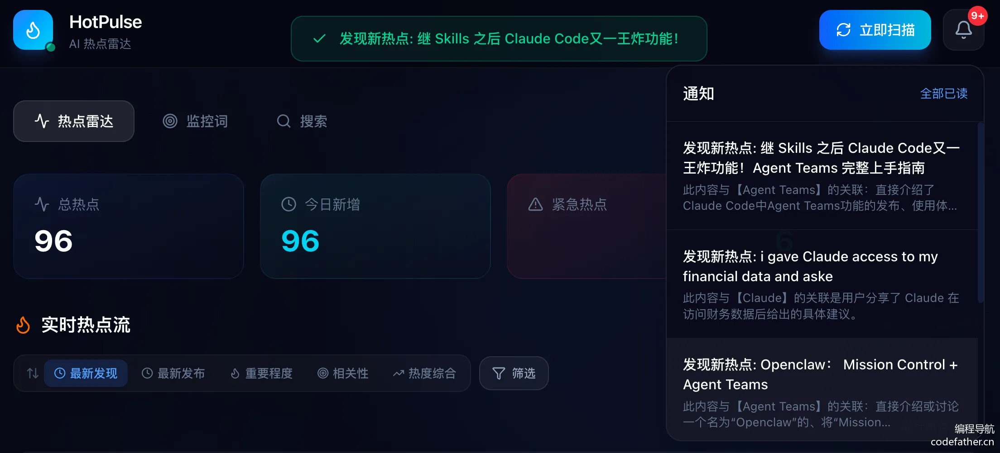
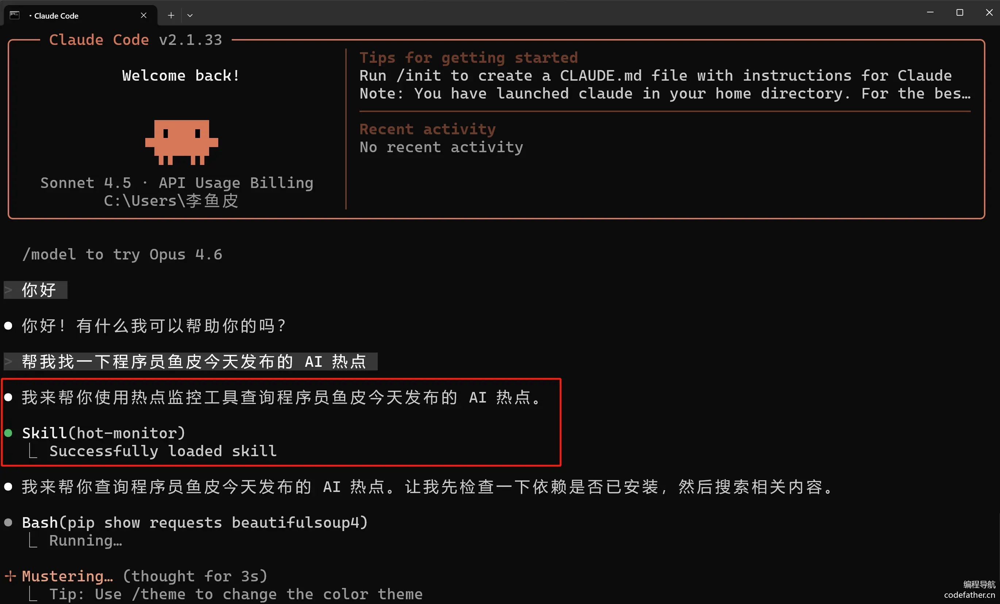
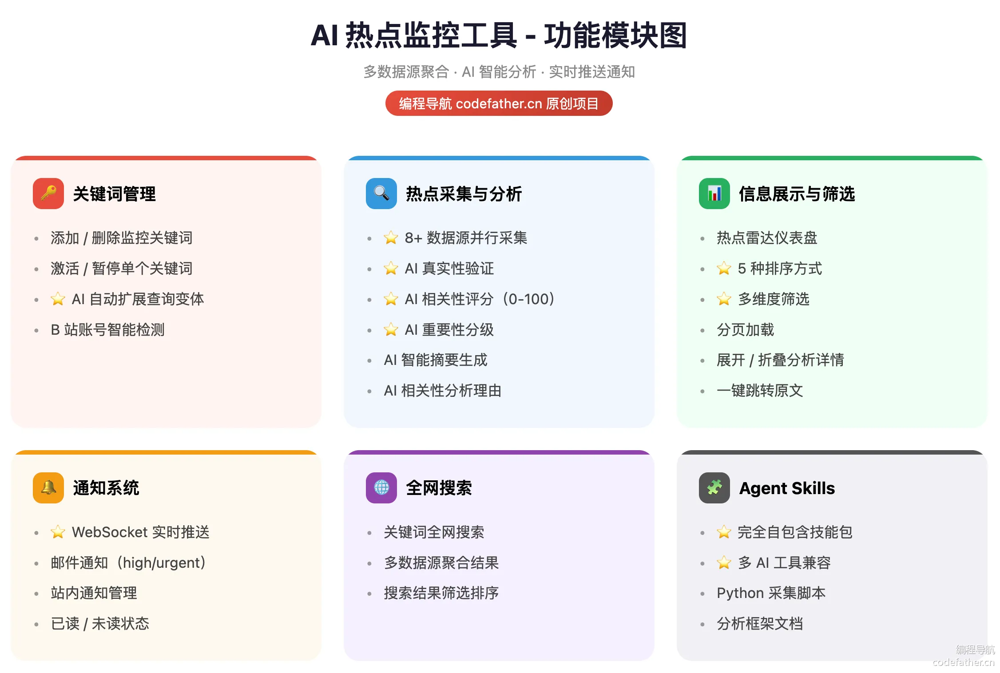
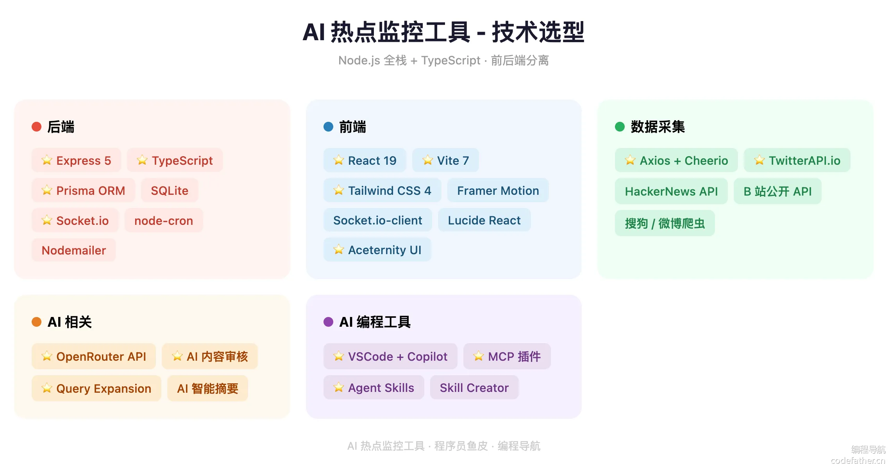
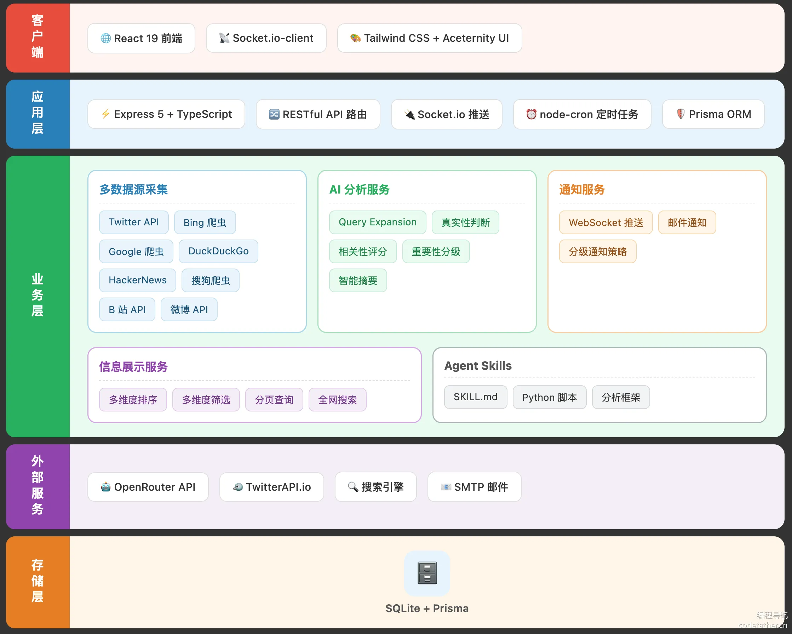
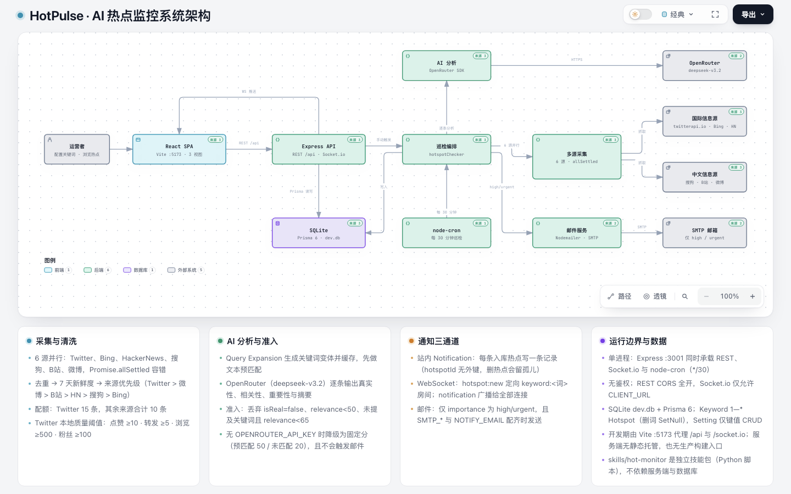

# 项目总览

## 二、项目功能演示

1）配置监控关键词

用户输入要监控的关键词，比如 "Vibe Coding"、"Claude" 等，系统会自动开始监控。支持激活⁢⁢⁢⁢⁢⁢⁢ / 暂停单个关键词              ⁢                          ⁢                   



2）AI 自动抓取和分析热点

系统每 30 分钟自动从 Twitter、Bing、HackerNews、搜狗、B 站、微博等 8+ 个信息源抓取内容，利用 AI 进行查询扩展、真假识别、相关性分析和智能摘要，过滤低质量内容后展示在信息流中。



3）多维度筛选和排序

支持按信息来源、重要性、时间范围进行筛选，支持按热度综合、相关性、发布时间排序，帮助用户快⁢⁢⁢⁢⁢⁢⁢⁢⁢速定位需要的热点信息。



4）全网搜索

除了监控关键词的实时热点流外，还可以直接搜索特定的关键词，从全网获取信息。



5）实时通知

通过 WebSocket 实时推送热点通知，高重要性的热点还会通过邮件通知。



6）Agent Skills 技能包

将热点监控能力封装为标准的 Agent Skills，安装后在 Cursor、VSCode Copilot、Claude Code 等等 AI 编程工具中都能使用。



## 五、项目功能梳理



关键词管理模块：

-   添加 / 删除监控关键词
-   激活 / 暂停单个关键词
-   AI 自动扩展查询变体（Query Expansion）
-   B 站账号智能检测

热点采集与分析模块：                               ⁢                 ⁢⁢⁢⁢                

-   8+ 数据源并行采集（Twitter、Bing、搜狗、B 站、微博、HackerNews 等）
-   AI 内容真实性验证（过滤标题党和虚假内容）
-   AI 相关性评分（0-100 分）
-   AI 重要性分级（urgent / high / medium / low）
-   AI 智能摘要生成
-   AI 相关性分析理由

信息展示与筛选模块：       
-   热点雷达仪表盘（实时统计数据）
-   5 种排序方式（最新发现 / 最新发布 / 重要程度 / 相关性 / 热度综合）
-   多维度筛选（来源 / 重要性 / 关键词 / 时间范围）
-   分页加载
-   展开 / 折叠相关性分析详情
-   一键跳转原文

通知系统模块：

-   WebSocket 实时推送
-   邮件通知（仅 high / urgent 级别）
-   站内通知管理（已读 / 未读）

全网搜索模块：

-   全网关键词搜索
-   多数据源聚合搜索结果

Agent Skills 模块：              

-   完全自包含的 AI 技能包
-   支持 Cursor、VSCode Copilot、Claude Code 等多工具
-   Python 采集脚本 + 分析框架
-   无需后端服务，开箱即用

## 六、技术选型

本项目以 Node.js 全栈 + TypeScript 为核心，前后端分离，涵盖多源爬虫数据采集、AI 大模型内容审核、WebSocket 实时推送、定时任务调度、Aceternity UI 科技感前端、Agent Skills 开发等实用技术，一个项目即可掌握工具类产品的核心技术栈。


### 后端

-   ⭐️ Express 5，Node.js Web 框架，原生支持 async/await
-   ⭐️ TypeScript，类型安全开发
-   ⭐️ Prisma ORM，类型安全的数据库访问
-   SQLite，轻量级嵌入式数据库
-   ⭐️ Socket.io，WebSocket 实时通信
-   node-cron，定时任务调度
-   Nodemailer，邮件发送

### 前端

-   ⭐️ React 19，前端 UI 框架
-   ⭐️ Vite 7，新一代前端构建工具
-   ⭐️ Tailwind CSS 4，原子化 CSS 框架
-   Framer Motion，React 动画库
-   ⭐️ Aceternity UI 风格组件，科技感视觉动效
-   Socket.io-client，WebSocket 客户端
-   Lucide React，图标库

### 数据采集

-   ⭐️ Axios + Cheerio，网页爬虫（Bing / Google / DuckDuckGo / 搜狗）
-   ⭐️ TwitterAPI.io，Twitter 高级搜索
-   HackerNews Algolia API，技术社区热门内容
-   B 站公开 API，视频搜索和账号检测

### AI 相关

-   ⭐️ OpenRouter API，统一接入 AI 大模型（DeepSeek、Claude、GPT 等）
-   ⭐️ AI 内容审核，真假识别 + 相关性分析 + 重要性分级 + 摘要生成
-   ⭐️ Query Expansion，AI 驱动的查询扩展

### AI 编程工具

-   ⭐️ VSCode + GitHub Copilot，主力 AI 编程 IDE
-   ⭐️ MCP 插件：Firecrawl（网页抓取）、Context7（最新技术文档）
-   ⭐️ Agent Skills：UI UX Pro Max（前端美化）、Skill Creator（技能开发）

## 七、架构设计

本项目采用前后端分离架构，前端使用 React + Vite，后端使用 Express + Prisma，通过 REST API 和 WebSocket 通信。通过定时任务引擎来驱动多数据源采集和 AI 分析，Agent Skills 作为独立模块可在多种 AI 编程工具中复用。



### 7.1 交互式系统架构图

比上面的分层能力图更进一步，下面这张图按**运行单元与调用关系**建模：13 个组件、14 条带协议 / 动作标签的连线，串起"用户请求路径"与"定时巡检路径"两条主线，支持缩放、聚焦、亮 / 暗主题切换与导出（PNG / SVG / WebM）。

- 打开交互式架构图（可缩放、可搜索、可导出）：[hotpulse-architecture.html](architecture/hotpulse-architecture.html)
- 图定义（可校验、可再生成的 JSON）：[architecture/candidate.json](architecture/candidate.json)



> 亮 / 暗两套主题可在交互图内切换；2048 视口与暗色截图见 `architecture/visual-check-2/`。

### 7.2 读图要点（以代码为准）

| 主题 | 说明 |
|------|------|
| 运行形态 | Express `:3001` 单进程同时承载 REST 路由、Socket.io 与 node-cron；开发期由 Vite `:5173` 代理 `/api` 与 `/socket.io`，服务端没有静态托管与生产构建入口 |
| 巡检链路 | 每 30 分钟（`*/30 * * * *`）或 `POST /api/check-hotspots` 触发：读取激活关键词 → B 站账号检测 → Query Expansion（进程内缓存）→ 6 源 `Promise.allSettled` 并行采集 → URL 去重 → 7 天新鲜度 → 来源优先级 → 配额（Twitter 15 / 其他源共 10）→ AI 逐条分析 → 阈值过滤 → 入库 |
| AI 准入 | OpenRouter（`deepseek/deepseek-v3.2`）产出 `isReal`、`relevance`（0-100）、`importance`、`summary` 与分析理由；丢弃假内容、`relevance < 50`、以及"未提及关键词且 `relevance < 65`"的内容 |
| AI 降级 | 未配置 `OPENROUTER_API_KEY` 时使用固定分（预匹配 50 / 未匹配 20），只保留预匹配命中的内容，且不会触发邮件 |
| 通知三通道 | 站内 Notification（每条入库热点一条）；Socket.io `hotspot:new` 定向 `keyword:<关键词>` 房间、`notification` 广播给全部连接；SMTP 邮件仅 `high` / `urgent` 且 SMTP 相关环境变量配齐时发送 |
| 数据模型 | SQLite + Prisma 6，共 4 张表：`Keyword 1—* Hotspot`（删除关键词时 `SetNull`）、`Notification.hotspotId` 仅普通字段（无外键，删热点会留孤儿）、`Setting` 为键值表（仅 CRUD，未参与运行逻辑） |
| 外部依赖 | OpenRouter、twitterapi.io（需 API Key）、Bing / HackerNews / 搜狗 / B 站 / 微博、SMTP |
| 已知边界 | 无鉴权；REST `cors()` 全开，Socket.io 仅允许 `CLIENT_URL`；采集依赖各平台页面结构或公开 API，平台改版会导致解析失效 |

> 口径说明：产品文案中的"8+ 信息源"指已实现能力；**默认巡检链路实际并行 6 个源**（Twitter、Bing、HackerNews、搜狗、B 站、微博），Google / DuckDuckGo 的采集实现已内置但未接入默认流水线（见 `server/src/jobs/hotspotChecker.ts:84-91`）。

### 7.3 图的证据与再生成

- 源码版本锁定：`aff0ade2cb2c9277d76b579607071456d15354d4`；图中每个组件在 `candidate.json` 的 `sources` 里带仓库相对路径与行号（`server/src/**`、`client/src/**`、`server/prisma/schema.prisma`）。
- 交付回执：[architecture/review-2/hotpulse-architecture.finalize-summary.json](architecture/review-2/hotpulse-architecture.finalize-summary.json) —— showcase 9/9 检查项、0 错误、0 警告；1440×900 / 1600×1000 / 1920×1080 / 2048×1320 四档视口与亮 / 暗主题均通过，无横向溢出。
- 重新生成（在仓库根目录执行，需要本机 Chrome / Chromium，可用 `ARCHIFY_CHROME` 指定可执行文件路径）：

```bash
ARCHIFY=/path/to/archify   # 本机已安装的 archify skills 目录
node "$ARCHIFY/bin/archify.mjs" finalize architecture docs/architecture/candidate.json \
  docs/architecture/hotpulse-architecture.html \
  --repo-root . --quality showcase --json --out-dir docs/architecture/<新的回执目录>
```
